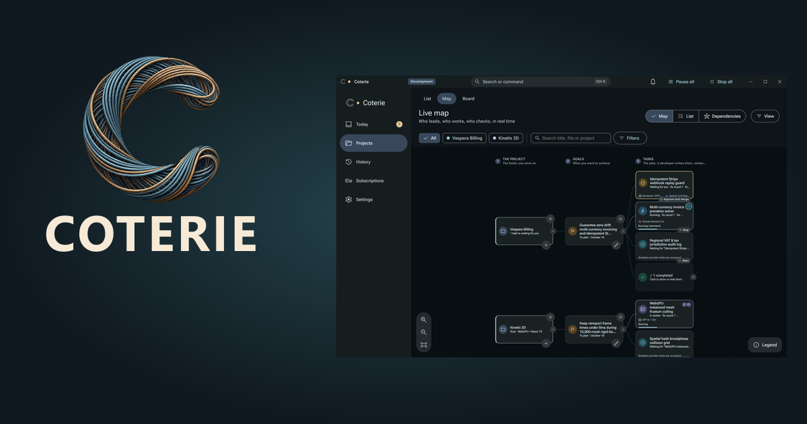
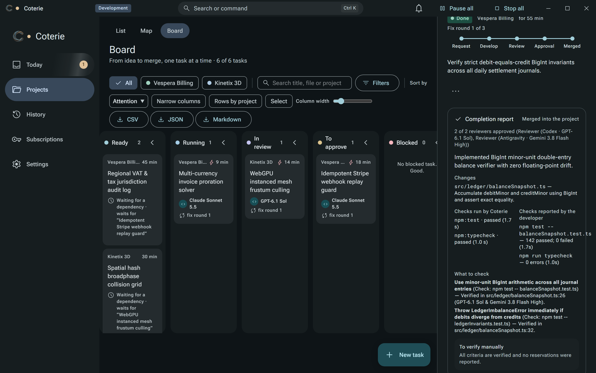

  

# Coterie AI Multi-Agent-Orchestrator

**Plan, build and review across AI coding CLIs.**

Coterie is a Windows desktop app that coordinates official AI coding CLIs: an Architect plans the work, Builders implement independent tasks in parallel, and a different model reviews the changes.

**[Request private beta access](https://offlinestudio.eu/coterie)** · [Watch the walkthrough](https://offlinestudio.eu/coterie#presentation-stage) · [Read the workflow](docs/workflow.md) · [Report a bug](https://github.com/CoterieApp/Coterie/issues/new/choose)

> **Private beta · Windows 10 and Windows 11, 64-bit.** Beta access is free and available on request. Provider accounts, supported CLI requirements and usage limits still apply.

## From a goal to a reviewable change

| Stage | What happens |
|---|---|
| **Architect** | Break a goal into scoped tasks, requirements and dependencies. |
| **Parallel Builders** | Work on independent tasks in separate Git worktrees, within configured capacity. |
| **Independent Reviewers** | Inspect proposed changes against requirements using a different model/provider. |
| **Checks and delivery** | Collect project-check results and a completion report before work advances under the project's approval and automation settings. |

The visual map, dependency views and task board help you follow what is running, waiting, under review or ready for your attention. Change inspection and completion reports keep the evidence available to review.

*Screenshots illustrate the product interface with demonstration projects. They are not evidence of a test run on your repository.*

## Start with the beta

1. [Request access on the Coterie website](https://offlinestudio.eu/coterie).
2. Follow the installation and onboarding instructions supplied when access is granted.
3. Start with a small Git project and one clearly scoped change.
4. Review task requirements, the proposed changes and check results before approving work.

See [getting started](docs/getting-started.md), [the FAQ](docs/faq.md) and [troubleshooting](docs/troubleshooting.md).

## What this repository contains

This is Coterie's **public documentation and feedback hub**. The application source is maintained privately. There are no application build instructions or public installer downloads in this repository at this stage.

| Location | Purpose |
|---|---|
| [`docs/`](docs/README.md) | Beta guidance, workflow, FAQ and public development priorities. |
| [`assets/`](assets/README.md) | Selected public product images. |
| [Issues](https://github.com/CoterieApp/Coterie/issues) | Reproducible bugs, feature requests and feedback. |
| [`CHANGELOG.md`](CHANGELOG.md) | Updates to this public hub. |
| [`SECURITY.md`](SECURITY.md) | How to report sensitive problems privately. |

## Feedback that helps

Tell us what you tried, what happened and what you expected. Include your Coterie build and relevant CLI versions. Remove credentials, private code, customer data and personal paths from screenshots or logs.

Read [contribution guidance](CONTRIBUTING.md) before posting. For beta access, account-specific help or a potential vulnerability, contact **[coterie@offlinestudio.eu](mailto:coterie@offlinestudio.eu)** instead of opening a public issue.

## Availability, verification and rights

Parallel work and independent review provide additional checks; their results depend on the task requirements, models and configured project commands. Passing checks does not guarantee correct or secure software. Review the evidence against your project's needs.

Coterie is developed by **OfflineStudio**. Future commercial terms have not been announced here. This public repository does not grant an open-source license to the application. See [rights and attribution](RIGHTS.md).

## Maintaining this hub

Keep documentation, public assets and community configuration separate. **Any code changes must follow the project coding guidelines** and [maintenance rules](docs/maintenance.md). Application changes belong in the private product repository.
